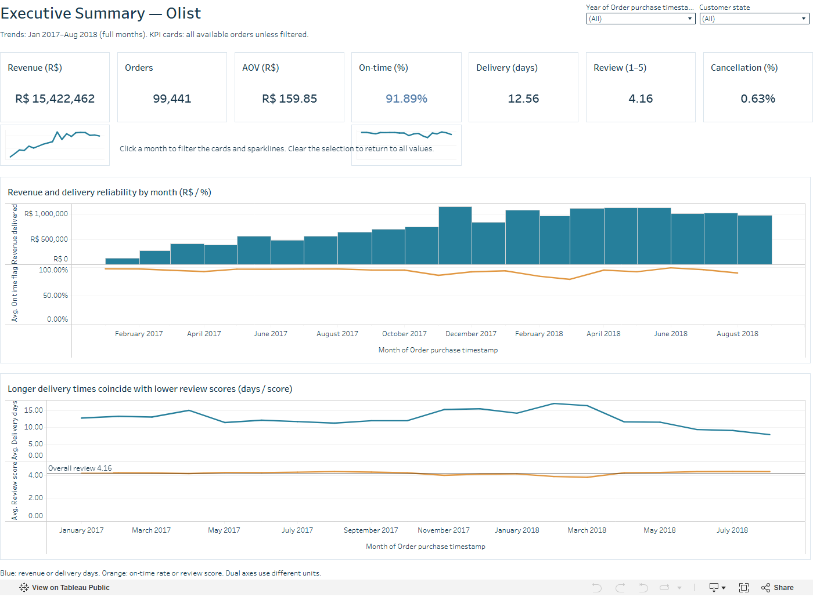
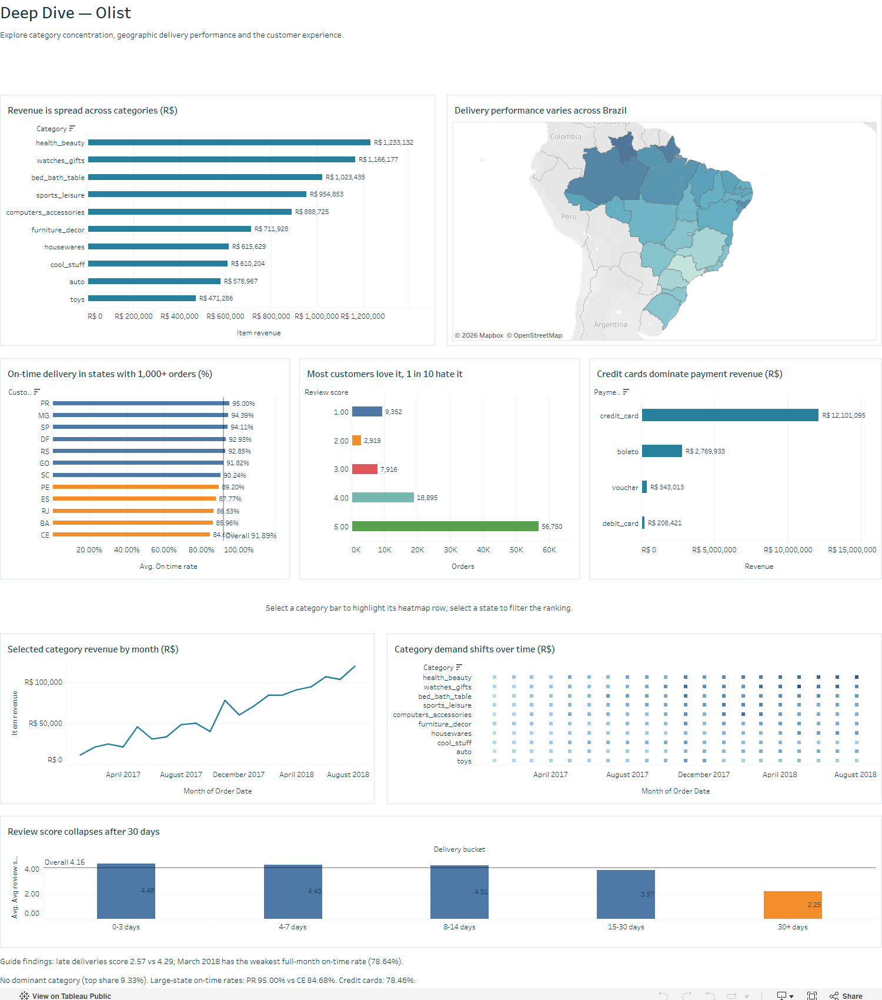
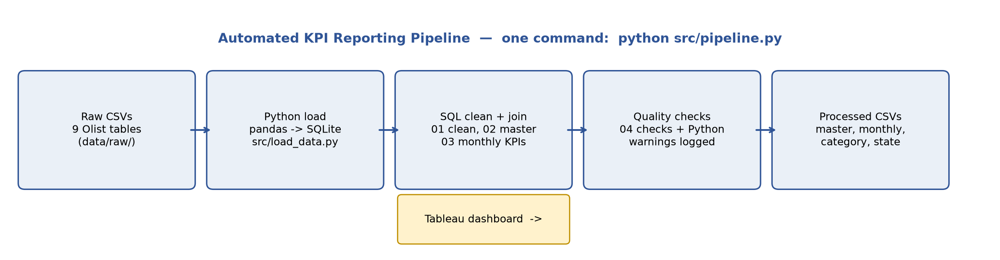

# Automated KPI Reporting Pipeline + Executive Dashboard

**SQL, Python, Tableau, GitHub — one command refreshes the whole weekly pack.**

## Business problem

Leadership needs a weekly view of order volume, revenue, delivery
performance and customer satisfaction, currently built manually.
This project builds an automated pipeline and dashboard that replaces
that manual build: raw Olist data goes in, clean reporting tables come
out with one command, and the Tableau dashboard reads those tables.

## Dashboard preview

The Tableau workbook is built from the processed tables in this repo
using the step-by-step guide in the separate Tableau Build Pack
(see `dashboard/` note below). It is published on Tableau Public,
and the workbook file is in this repo at
`dashboard/Olist_KPI_Reporting_Advanced.twbx` (20 worksheets,
2 dashboards: Executive Summary + Deep Dive, with parameters,
LOD calculations and dashboard actions from the advanced guide).

- Page 1 — Executive Summary: KPI cards, monthly revenue trend with
  growth %, filters for year and state (from master_orders).
- Page 2 — Deep Dive: Top 10 categories by revenue, delivery map by
  state, review score vs delivery delay, drill-down by category/state.

Note on filters: product category lives at item grain, not order
grain, so it cannot filter the order-level KPI cards on Page 1
without double-counting payments. Category filtering therefore lives
on Page 2, where the data is item-grain. See the Build Pack guide.

**Tableau Public link:** https://public.tableau.com/app/profile/isfaque.ansari5273/viz/Olist_KPI_Reporting_Advanced/ExecutiveSummary

## Architecture

Raw CSVs → Python load (pandas → SQLite) → SQL clean / join / monthly
KPIs → data quality checks (warnings logged) → processed CSVs →
Tableau. On Alteryx this same flow would be a drag-and-drop workflow
(Input Data → Select/Clean → Join → Summarize → Output Data, with a
Test tool for the quality checks). The logic is identical; only the
tool changes.

## Tech stack

SQL (CTEs, window functions with `LAG`, `CASE`, `ROW_NUMBER`),
Python (pandas, SQLAlchemy, sqlite3), SQLite, Tableau Public, GitHub.

## KPIs tracked (8)

Total revenue, total orders, average order value, month-over-month
growth %, on-time delivery rate, average delivery days, average review
score, cancellation rate. Exact formulas: `docs/kpi_definitions.md`.

**Verified headline numbers** (99,441 orders, Sep 2016 – Oct 2018):

| KPI | Value |
|---|---|
| Total revenue (delivered orders) | R$ 15,422,461.77 |
| Total orders / delivered | 99,441 / 96,478 |
| Average order value | R$ 159.85 |
| On-time delivery rate | 91.89% |
| Average delivery days (median 10.22) | 12.56 days |
| Average review score | 4.16 |
| Cancellation rate | 0.63% |
| Peak month | Nov 2017, R$ 1,153,528.05 (+53.6% MoM) |

## How to run

1. Download the Brazilian E-Commerce dataset from Kaggle
   (https://www.kaggle.com/datasets/olistbr/brazilian-ecommerce)
   into `data/raw/` — the 9 CSVs listed in `docs/data_dictionary.md`.
   Raw data is git-ignored; only the processed tables are pushed.
2. `pip install -r requirements.txt`
3. `python src/pipeline.py`

That one command loads the data, runs `sql/01` → `02` → `03`,
runs the quality checks, and exports `data/processed/`:
`master_orders.csv` (99,441 rows), `kpi_monthly.csv` (25 rows),
`category_monthly.csv` (1,273 rows), `delivery_by_state.csv`
(27 rows). A run takes about a minute. The log is in
`logs/pipeline_run.log`.

To explore first: `notebooks/01_eda.ipynb` (49 cells, executed).

## Key insights (3–4 bullets; full version in `docs/insights.md`)

- **Late deliveries cut review scores from 4.29 to 2.57 (−40.2%).**
  Scores hold to 14 days, then collapse past 30 days (2.25).
- **Revenue peaks in November 2017** (R$ 1,153,528.05, +53.6% MoM),
  but that month's on-time rate falls to 85.7% — the peak strains delivery.
- **No hero category:** health_beauty leads at only 9.3% of delivered
  item revenue; the top 10 together are 62.4%.
- **Delivery is geographic:** São Paulo averages 8.76 days, while
  Bahia (19.34), Ceará (21.27) and Maranhão (21.57) routinely miss.

## Data quality issues found

- 551 orders have duplicate reviews — latest review kept.
- 8 delivered orders have no delivery date — excluded from delivery
  KPIs, not imputed.
- 610 products missing category/name/description; 2 categories with
  no English translation (Portuguese name kept).
- Partial months at both ends — trend uses full months Jan 2017 –
  Aug 2018 only (`is_full_month` flag).
- Full log: `docs/data_quality_log.md`.

## How I used GenAI

GenAI (Claude/ChatGPT-style assistance) was used to speed up SQL
debugging, suggest KPI definitions, and draft documentation. Every
number, query result and claim in this repo was then verified against
the real Olist data by running the pipeline and the EDA notebook —
nothing generated was kept unverified.

## Future improvements

- Schedule the refresh (cron / Airflow) instead of a manual run.
- Rebuild the same flow in Alteryx and add a screenshot.
- Add a causal check (state × category) before acting on the
  late-delivery finding.

## Contact

LinkedIn: https://www.linkedin.com/in/isfaque-ansari-
