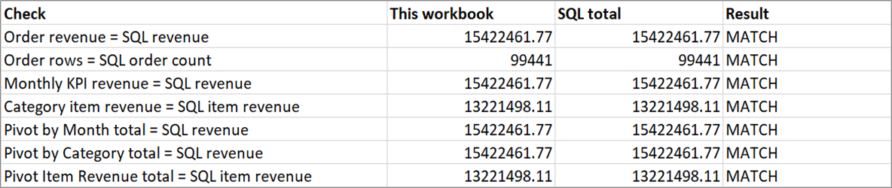
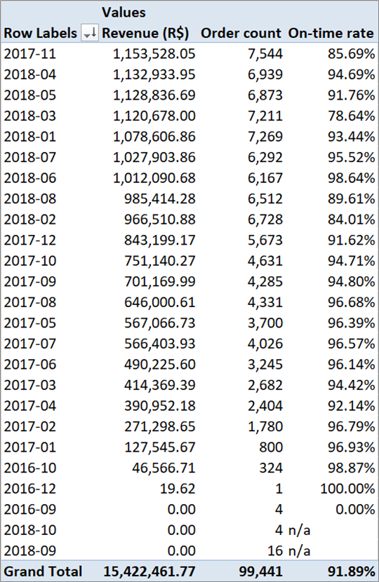
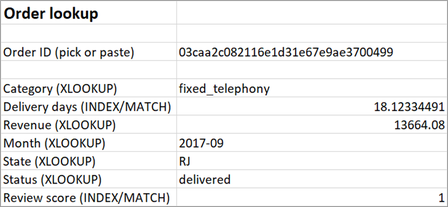
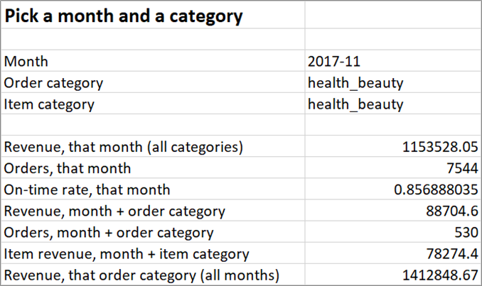

# Spreadsheet — Olist KPI workbook

`Olist_KPI_Spreadsheet.xlsx` (18 MB) is the Excel route to the same
numbers the SQL pipeline produces. Built by `src/build_spreadsheet.py`
from `data/processed/`, with the PivotTables created by Excel itself.

## Sheets

| Sheet | What it is |
|---|---|
| Read me | Orientation and the category-attribution rule |
| Orders | 99,441 rows, one per order, as an Excel table (`tblOrders`) |
| Category | 1,273 rows, month × category item revenue (`tblCategory`) |
| Monthly KPIs | 25 rows, the 8 KPIs per month (`tblMonthly`) |
| Pivot by Month | Native PivotTable: revenue, order count, on-time rate by month |
| Pivot by Category | Native PivotTable: the same measures by order category |
| Pivot Item Revenue | Native PivotTable on `tblCategory`: item revenue by category |
| Order Lookup | XLOOKUP + INDEX/MATCH on a chosen `order_id` |
| Selector | Month / category dropdowns driving SUMIFS answers |
| Checks | Live formulas comparing the workbook with the SQL totals |
| Lists | Hidden source ranges for the dropdowns |

## Verified against SQL

The **Checks** sheet holds seven live formulas. All seven returned
`MATCH` when the workbook was built and recalculated in Excel on
2026-11-09:

| Check | Value |
|---|---|
| Order revenue = SQL revenue | 15,422,461.77 |
| Order rows = SQL order count | 99,441 |
| Monthly KPI revenue = SQL revenue | 15,422,461.77 |
| Category item revenue = SQL item revenue | 13,221,498.11 |
| **Pivot by Month grand total** | **15,422,461.77** |
| **Pivot by Category grand total** | **15,422,461.77** |
| Pivot Item Revenue grand total | 13,221,498.11 |





The pivot totals are read with `GETPIVOTDATA`, so the check follows the
pivot if it is filtered or rearranged — it is not a hard-coded number.

## Why the category pivot can total the order revenue

Product category is **item grain**: one order can contain several
categories, which is why `master_orders` has no category column and why
summing payments by category would double-count.

To make a category breakdown that still totals R$ 15,422,461.77, the
build script attributes each order to **one** category: the category of
its highest-priced item (ties broken by the lowest `order_item_id`).
Every order is counted once, so the grand total is exact. The 775 orders
with no items sit in `no_items` and carry R$ 0 revenue.

That is an attribution choice, not the true item-level split. For the
true split use **Pivot Item Revenue**, which totals R$ 13,221,498.11 in
item price and is not expected to equal payment revenue
(`docs/kpi_definitions.md`).

## Lookups and validation

- **Order Lookup**: `XLOOKUP` returns category, revenue, month, state and
  status; `INDEX`/`MATCH` returns delivery days and review score. An
  unknown ID returns "order not found" rather than an error.
- **Selector**: three dropdowns (month, order category, item category)
  backed by hidden named ranges, with input validation. Changing them
  recalculates revenue, order count, on-time rate and item revenue.





## Rebuild

```bash
python src/pipeline.py            # refresh data/processed/
python src/build_spreadsheet.py   # rebuild this workbook
```

Requires **desktop Excel on Windows** (the script drives Excel through
COM to create native PivotTables; openpyxl cannot create them) plus
`openpyxl` and `pywin32`. The build prints the seven check results; do
not publish the workbook if any says `MISMATCH`.

The raw Kaggle files are needed only to derive the order category. On a
machine without Excel, use `data/processed/kpi_monthly.csv` directly —
see `docs/self-service-guide.md`.
